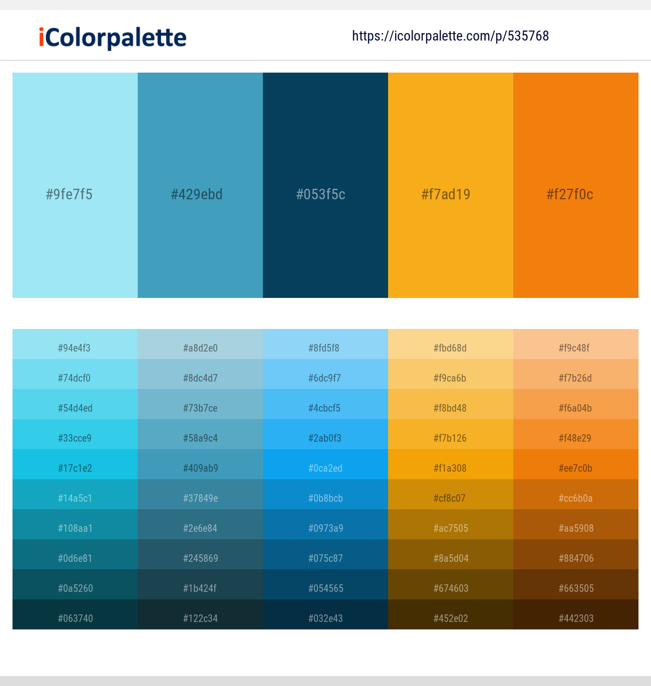

# Validate colours

Five colours, each with a ten-step ladder from light to dark. The palette was made on
[iColorpalette](https://icolorpalette.com/p/535768) and chosen as the Validate palette; the image is kept
here as the reference. Every hex value below was checked against the pixels of that image.

> **Status: chosen, not yet applied.** The console today uses a different, green accent
> (`--accent: #0e6b58` in `frontend/src/tokens.css`). Nothing in the product, the proposal or the demo has
> been recoloured to this palette yet. This page records the decision and how to use the colours safely, so the
> change can be made once and consistently.

## The five colours

| Name (proposed) | Hex | Suggested role |
| --- | --- | --- |
| Sky | `#9fe7f5` | Light backgrounds, highlights, selected rows |
| Blue | `#429ebd` | Primary actions and links (as a fill or border) |
| Ink | `#053f5c` | Text, headings, the dark brand colour |
| Amber | `#f7ad19` | Attention, "needs a person", warnings |
| Orange | `#f27f0c` | A strong accent, used sparingly |

The names are suggestions so people can say "ink" instead of reading a hex code; rename them if the brand already has names.

## Ladders (light to dark)

Step 1 is the lightest, step 10 the darkest. Steps 5 to 6 sit closest to the main colour.

| Step | Sky | Blue | Ink | Amber | Orange |
| --- | --- | --- | --- | --- | --- |
| 1 | `#94e4f3` | `#a8d2e0` | `#8fd5f8` | `#fbd68d` | `#f9c48f` |
| 2 | `#74dcf0` | `#8dc4d7` | `#6dc9f7` | `#f9ca6b` | `#f7b26d` |
| 3 | `#54d4ed` | `#73b7ce` | `#4cbcf5` | `#f8bd48` | `#f6a04b` |
| 4 | `#33cce9` | `#58a9c4` | `#2ab0f3` | `#f7b126` | `#f48e29` |
| 5 | `#17c1e2` | `#409ab9` | `#0ca2ed` | `#f1a308` | `#ee7c0b` |
| 6 | `#14a5c1` | `#37849e` | `#0b8bcb` | `#cf8c07` | `#cc6b0a` |
| 7 | `#108aa1` | `#2e6e84` | `#0973a9` | `#ac7505` | `#aa5908` |
| 8 | `#0d6e81` | `#245869` | `#075c87` | `#8a5d04` | `#884706` |
| 9 | `#0a5260` | `#1b424f` | `#054565` | `#674603` | `#663505` |
| 10 | `#063740` | `#122c34` | `#032e43` | `#452e02` | `#442303` |

The ladder in the third column starts from a light sky-blue, because it is the ladder of the dark Ink colour.

## Using them so the text can be read

Contrast ratios below are computed from the hex values (WCAG 2.x relative luminance). Body text needs at least
4.5:1; large text (about 24 px, or 19 px bold) and interface borders and icons need at least 3:1.

| Pairing | Ratio | Use for |
| --- | --- | --- |
| Ink `#053f5c` on white | 11.2 | All text |
| Ink on Sky `#9fe7f5` | 8.1 | All text |
| Ink on Amber `#f7ad19` | 5.9 | All text (buttons, banners) |
| Ink on Orange `#f27f0c` | 4.2 | Large text only |
| Ink text on Blue `#429ebd` | 3.7 | Large text only |
| White on Ink | 11.2 | All text |
| White on Blue `#429ebd` | **3.1** | **Large text only**: fails for body text |
| White on Orange `#f27f0c` | **2.7** | **Do not use for text** |
| Blue `#429ebd` on white | 3.1 | Borders, icons, large text; not small text |
| Orange `#f27f0c` on white | 2.7 | Borders and icons only |
| Amber `#f7ad19` on white | 1.9 | Fills and icons only, never text |
| Sky `#9fe7f5` on white | 1.4 | Fills only, never text |

Rules that follow:

1. **Text is Ink on a light background, or white on Ink.** Everything else is a fill, a border or an icon.
2. **A bright colour is never small text on white.** When a coloured word is needed, use a darker step: Blue step 7
   `#2e6e84` on white is 5.7, Orange step 7 `#aa5908` is 5.1, Amber step 8 `#8a5d04` is 5.8. White on Blue step 7 is also 5.7.
3. **Do not rely on colour alone.** A status needs a word or an icon as well as a colour (people with colour-blindness, and
   printouts in black and white). Amber against Orange in particular is hard to tell apart.
4. **Check dark mode separately.** The Ink ladder gives a dark background (`#032e43`, `#054565`); text on it should be Sky
   or white, and the same contrast table applies.

## Where this should be applied (not done yet)

- `frontend/src/tokens.css`: replace the green accent and the warning colours with the roles above, then re-run the browser
  tests and re-check contrast on every screen.
- The proposal document and its PDF, the demo's cover art and the model cards' tables, if they should carry the brand.

If you want the console recoloured, that is a separate, reviewable change: it touches every screen's look and should be checked
with the screenshots the browser tests already take.
